<p align="center">
  
</p>

# SMRFORGE website

The public site at **[smrforge.io](https://smrforge.io)** — a set of static pages served by GitHub
Pages. No build step, no server, no framework: open any page in a browser and it works.

The whole site exists to make one claim checkable rather than asked-for:

> Reactor physics you can prove. Every result becomes a sealed evidence bundle anyone can verify
> **offline** — and re-derive by re-running the open engine on its recorded inputs. **Not "trust us" — check us.**

## Verify a bundle in 60 seconds (no install)

1. Open **[`check.html`](check.html)** (or [smrforge.io/check](https://smrforge.io/check.html)).
2. It loads a **real** signed evidence bundle and recomputes its fingerprints + Ed25519 signature
   **in your browser** — banner turns **VERIFIED**.
3. Edit one digit of the result and run it again — banner turns **BROKEN**, and it names the section
   that no longer matches its sealed fingerprint.
4. Put the digit back — **VERIFIED** again.

Pull your network cable first if you like: the verifier is self-contained and runs offline (air-gap-safe).

## What the pages are

| Page | What it does |
|---|---|
| [`index.html`](index.html) | Landing page — what SMRFORGE is and how the evidence model works. |
| [`check.html`](check.html) | The in-browser verifier. Recomputes a bundle's hashes + signature with no server. |
| [`break-the-seal.html`](break-the-seal.html) | A public dare: take a sealed result, alter it, and try to get it past the verifier. |
| [`info-sheet.html`](info-sheet.html) | One-page overview. |
| [`proof-layer.html`](proof-layer.html) | How the evidence/proof layer fits around the physics. |

## What the verifier actually is

[`check.js`](check.js) is a **from-scratch** RFC 8032 Ed25519 + SHA-256 verifier written in plain
browser JavaScript — no crypto library, no network. It recomputes every section hash, the bundle
roll-up, and the signature, and it holds the bundle to the same rules the command-line verifier does
(including rejecting non-canonical and small-order signature points). It is deliberately simple so you
can read it.

**What the seal proves:** the number in front of you is the number the engine produced, nothing altered
it, and the run can be re-derived from the inputs in the bundle. Under the public demo key it proves
*integrity*; under SMRFORGE's pinned production key it also proves *origin* ("this came from SMRFORGE").

**What it does not prove:** that the physics is *right*. A sealed number from a badly specified core is
a faithfully preserved wrong answer. SMRFORGE results are screening-to-reference grade and **advisory** —
check the number, then decide what it's worth. Nobody should license a reactor on a SMRFORGE number alone.

## Break the Seal

The challenge: forge a bundle that passes the verifier, or tamper with one undetectably. The verifier
runs offline, so attacks on the server, DNS, or hosting don't count — only the bundle and the public
verifier code. Submissions go by **email** (the address is on the [Break the Seal](break-the-seal.html)
page); GitHub issues aren't used for this. Every reproducing attempt gets credited.

## Local development

```bash
# serve the site locally (any static server works)
python -m http.server 8000      # then open http://localhost:8000/check.html

# run the parity gate: the browser verifier must accept/reject EXACTLY what the CLI does
node tests/verify.parity.mjs    # exits non-zero on any divergence
```

`tests/verify.parity.mjs` drives the canonical Ed25519 known-answer vectors
(`tests/ed25519_small_order_vectors.json`, vendored byte-identical from the open core) and the
admissibility rules through `check.js`, so a change here can never make the browser verifier disagree
with the command-line one.

## Related repositories

- **[smrforge](https://gitlab.com/smrforge/smrforge)** — the open reactor-physics engine + the
  standalone bundle verifier (MIT).
- **[evidence-verifier](https://gitlab.com/smrforge/evidence-verifier)** — a single-file, stdlib-only
  verifier a reviewer can run with none of the producing code.
- **[evidence-envelope-spec](https://gitlab.com/smrforge/evidence-envelope-spec)** — the bundle format
  the verifiers agree on.

## Notes for contributors

- This repo is **direct-to-`main`** (GitHub Pages serves `main`); keep the parity gate green before pushing.
- Keep the honest framing intact: *custody, not correctness*; *advisory, not a certification*; and the
  brand is always **SMRFORGE** (all caps). Cite only openly-distributable sources in any added copy.
- Report a security issue by email (see the Break the Seal page) — never put secrets or tokens in a page.
